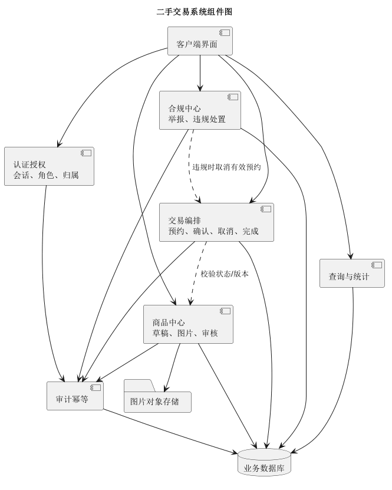
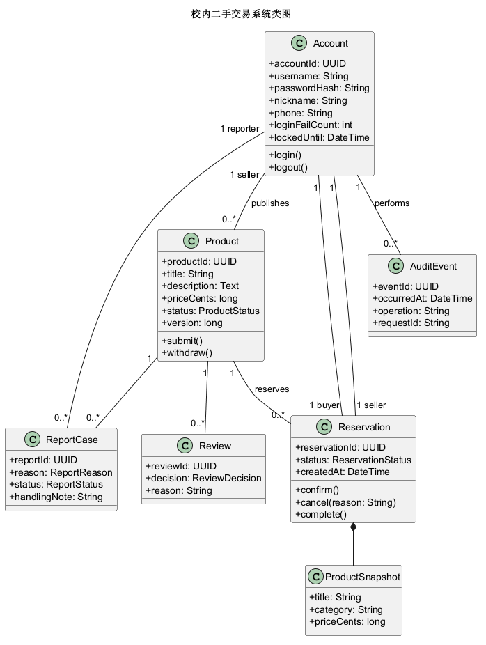
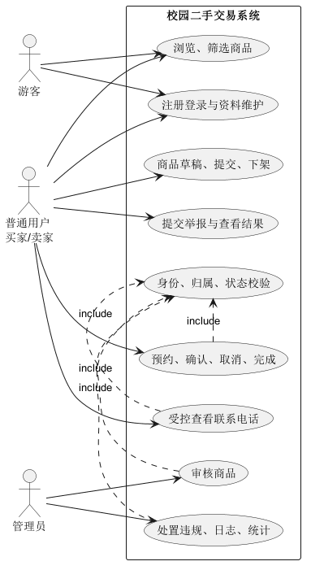
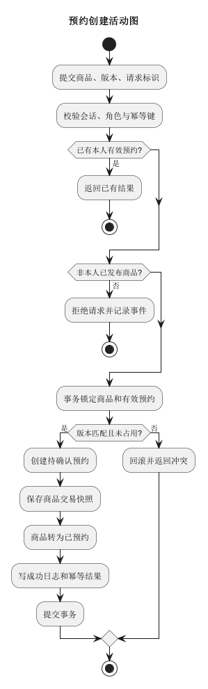
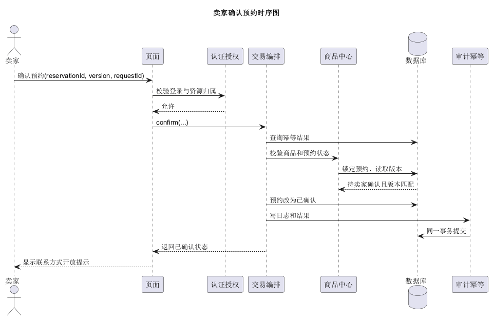
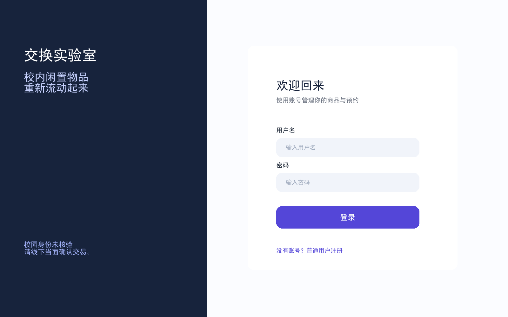
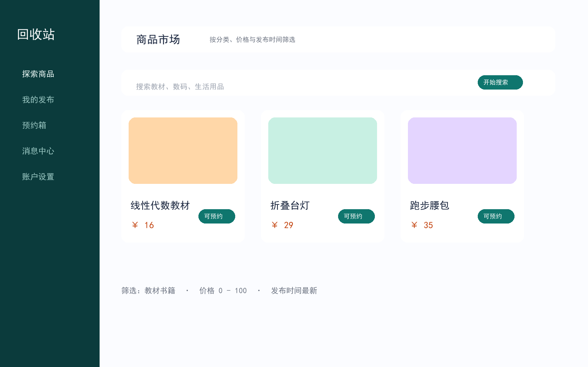
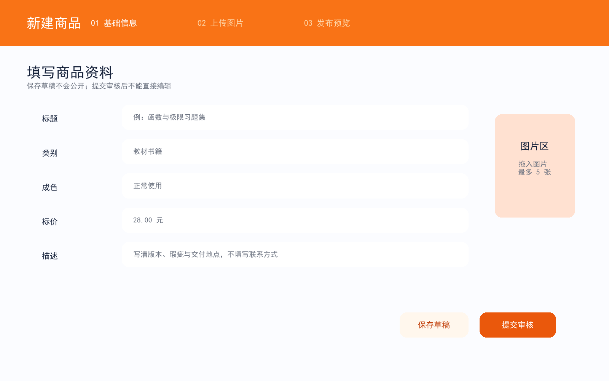
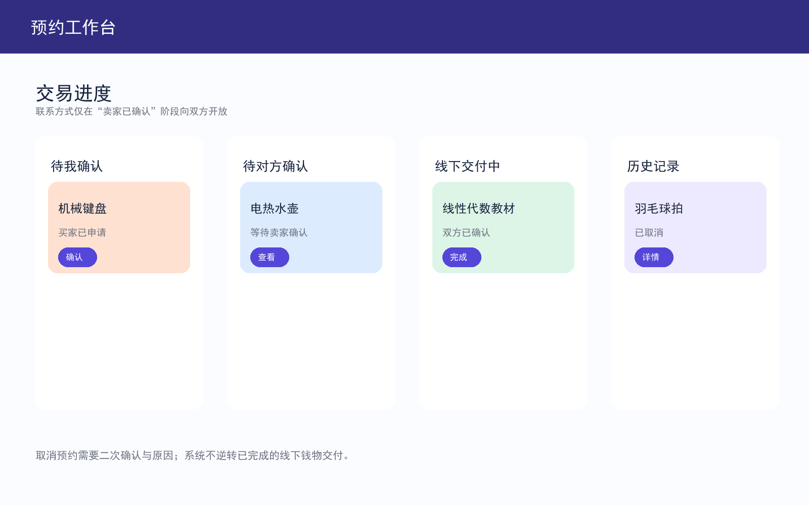
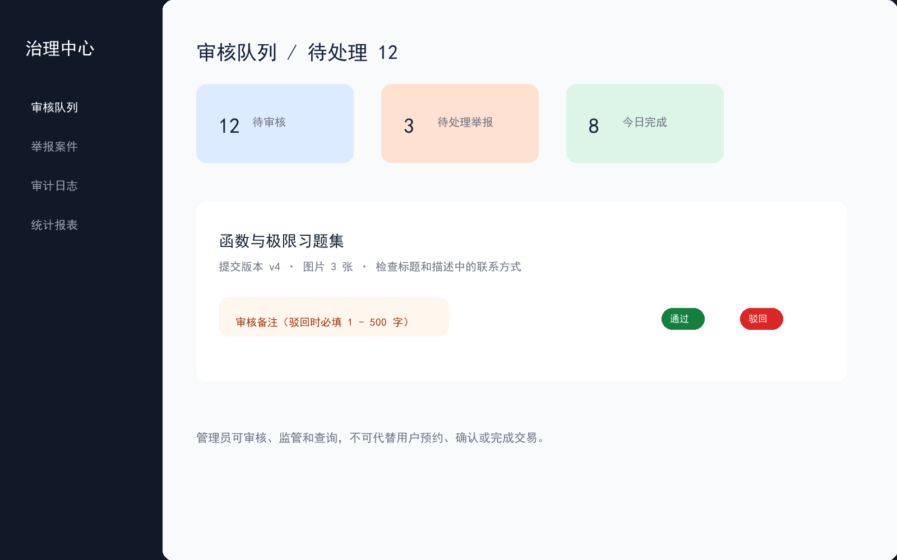

# 软件设计与建模实验报告

| 项目 | 内容 |
| --- | --- |
| 实验名称 | 实验二：软件设计与建模 |
| 项目名称 | 校内二手交易系统 |
| 学号 | 241220140 |
| 姓名 | 李扶文 |
| 需求依据 | `Lab1_requirement.md` |


## 1. 项目概述

本项目面向本校学生，设计一个校园二手交易教学原型。系统覆盖账号注册登录、商品草稿与审核、商品检索、线下交易预约、联系方式按状态开放、举报处置、日志和统计。系统使用虚构数据，界面必须显示“校园身份未核验”。

本阶段目标是形成可供后续实验实现的设计原型，不实现完整产品。明确不在本期范围内的功能包括：在线支付、退款、配送、聊天、评价、推荐、拍卖、议价订单、候补、申诉、实名核验、真实学校统一认证、密码重置、账号删除和用户自主角色变更。

## 2. 主要功能与需求追踪

| 模块 | 核心功能 | 对应需求 |
| --- | --- | --- |
| 账号与会话 | 普通用户/管理员注册、登录锁定、退出、空闲失效、资料维护 | REQ-002～005、REQ-028 |
| 商品管理 | 草稿、字段校验、图片、提交/撤回审核、发布后编辑和下架 | REQ-006～009 |
| 商品查询 | 关键词、分类、价格、状态组合筛选，排序、分页和可见范围 | REQ-010～011 |
| 预约交易 | 创建、卖家确认、取消、买家完成、交易快照和电话控制 | REQ-012～017、REQ-029～031 |
| 举报合规 | 举报提交、管理员结案、违规下架和预约联动取消 | REQ-018～019 |
| 统计审计 | 商品/成交统计、业务日志、安全事件、日志查询 | REQ-021～023 |
| 安全可靠性 | 授权、输入防护、幂等、事务、并发、备份恢复 | REQ-015、REQ-020、REQ-024～026、REQ-030 |

## 3. 总体架构与模块划分

系统采用“界面层 - 应用服务层 - 数据层”的分层结构。

1. 界面层：提供登录注册、市场浏览、商品编辑、预约工作台、举报、个人资料和管理员治理中心等入口；
2. 应用服务层：由认证授权、商品中心、交易编排、合规中心、查询统计和审计幂等组成。所有状态变化由服务层校验身份、资源归属、资源版本和当前状态。
3. 数据层：关系数据库保存账号、商品、预约、审核、举报、幂等记录、日志和快照；对象存储仅保存已校验的 JPEG/PNG 商品图片。

这样划分的原因是：商品审核、预约和举报均存在明确状态转换；把状态机和事务放在应用服务层可以避免只靠隐藏按钮实现权限控制。图片与业务记录分离能够降低数据库负担；预约快照和审计日志独立保存，保证后续查询不受商品编辑影响。



## 4. 关键设计决策

### 4.1 角色与授权

- 游客仅可浏览公开的已发布、已预约商品。
- 普通用户同时具有买家和卖家能力，但只能管理本人商品、本人预约和本人举报。
- 管理员可审核、处置举报、查询日志和统计；不能代替用户预约、确认、取消或完成交易，且不能查看密码、完整电话。
- 受限接口均在服务端校验：未登录返回 401；无权访问返回 403；不允许得知他人私有资源存在时返回 404。

### 4.2 商品与预约状态

商品状态为：草稿、待审核、审核驳回、已发布、已预约、已下架、已售出、违规下架。预约状态为：待卖家确认、已确认、已取消、已完成。

- 草稿提交后进入待审核；管理员通过后进入已发布，驳回后进入审核驳回。
- 只有已发布、非本人商品可创建预约。创建成功时商品与预约在同一事务内变为已预约和待卖家确认。
- 卖家确认后预约进入已确认；此时双方才可查看对方当前电话。
- 买家或卖家取消后预约进入已取消，商品恢复已发布；买家完成后预约进入已完成、商品进入已售出。
- 已预约商品被确认违规时，在同一事务中取消有效预约、收回电话访问权并将商品违规下架。

### 4.3 并发、幂等和快照

已认证业务写入使用“账号 ID + 操作类型 + 请求标识”作为幂等键。相同请求重试返回原结果，不重复改变状态和写入成功日志。创建预约时锁定商品和有效预约记录，同一商品最多保留一条有效预约。

交易快照保存预约创建时的标题、分类和价格；审核快照保存提交审核时的商品内容。商品后续编辑不改写历史快照。金额以整数分保存，避免浮点精度问题。

## 5. UML 设计

### 5.1 类图

类图定义了账号、商品、预约、商品快照、审核、举报和审计事件等核心实体。商品由卖家账号发布；预约关联买家、卖家和商品，并组合交易快照；举报关联商品和举报人；审计事件关联操作者和请求标识。



设计说明：`Product.version` 用于避免旧页面覆盖新状态；`Reservation` 的 `confirm/cancel/complete` 对应关键业务状态转换；`AuditEvent.requestId` 支持幂等追踪。该图应在实现时进一步映射为数据库主键、外键、唯一约束和枚举。

### 5.2 用例图

用例图明确游客、普通用户和管理员的权限边界。创建预约、查看联系电话、审核商品和违规处置均包含身份、归属和状态校验。



### 5.3 活动图

活动图选择“创建预约”这一并发风险最高的流程。流程先检查幂等结果，再校验商品归属和状态；只有锁定商品并确认未被占用后，才原子写入预约、快照、商品状态、幂等结果和成功日志。



### 5.4 时序图

时序图以“卖家确认预约”为例，说明页面、认证授权、交易编排、商品中心、数据库和审计幂等服务的交互顺序。确认操作必须校验卖家归属、预约状态和版本，并与审计日志同事务提交。



## 6. UI 原型与界面说明


### 6.1 登录入口



该页面提供登录和普通用户注册入口。登录失败信息应为通用提示，不暴露账号是否存在；密码、会话令牌和完整电话不得出现在页面错误信息或日志中。

### 6.2 商品市场



市场页支持关键词、分类、价格区间和排序组合筛选。每页 20 条，显示权限范围内总数。市场默认按发布时间倒序；已预约商品可以浏览但不显示再次预约按钮。

### 6.3 商品编辑



编辑页区分“保存草稿”和“提交审核”。商品图片最多 5 张，仅接收可解码的 JPEG/PNG，单张不超过 5MB。标题和描述以纯文本保存、展示，不能执行脚本。

### 6.4 预约工作台



预约页以待确认、已确认、线下交付中和历史记录区分状态。卖家确认后开放电话；预约取消、完成或违规处置后立即收回电话访问权。取消时要求明确原因和二次确认。

### 6.5 管理员治理中心



管理员可查看待审核商品、待处理举报和统计摘要。审核驳回和举报结案都必须填写 1～500 字说明；违规处置已预约商品时，界面应提示该操作会取消有效预约且不会让商品回到市场。

## 7. 数据库与接口约束建议

| 数据对象 | 关键字段/约束 |
| --- | --- |
| 账户 | `lower(username)` 唯一；密码使用独立盐哈希；电话为私有字段 |
| 商品 | 主键、卖家外键、状态、版本、整数分价格；不物理删除 |
| 商品图片 | 商品外键，数量不超过 5，保存系统文件名和内容类型 |
| 预约 | 商品、买家、卖家外键；有效预约唯一；保存交易快照 |
| 举报 | 举报人和商品外键；同一举报人同一商品最多一条待处理举报 |
| 幂等记录 | `(actorId, operation, requestId)` 唯一；保留至课程结束 |
| 审计日志 | 时间、操作者、资源、操作、请求标识、结果、原因码、前后状态 |

## 8. AI 辅助工具使用记录

### 8.1 使用场景

使用大模型辅助梳理需求、检查状态转换、形成 PlantUML 初稿、规划界面信息层级和生成报告提纲。使用 PlantUML 将 `.puml` 渲染为 PNG，用于保证源文件与图像一致。

### 8.2 人工审查和修改

人工审查重点包括：

1. 按需求编号检查功能是否超出范围，避免加入支付、聊天等非本期功能。
2. 检查普通用户、管理员和游客权限边界，确认管理员不能代办交易。
3. 检查商品和预约状态是否允许非法转换。
4. 检查并发预约、重试、版本冲突、日志原子性和交易快照是否被体现。
5. 检查 UML 图是否由对应 `.puml` 直接渲染，检查 UI 是否包含状态和隐私提示。

### 8.3 优点、局限与反思

AI 能快速生成图表和界面草稿，帮助发现遗漏的实体、状态和异常分支；但其生成结果可能存在错误关联、泛化描述、视觉布局不规范或忽略安全边界的问题。因此，AI 只能作为辅助工具，最终设计必须由需求追踪、人工审查和实际渲染验证决定。

最终采用的工作流为：先人工列出需求和约束 → 让 AI 生成初稿 → 对照需求逐项审查 → 用 PlantUML 渲染 → 检查图和界面 → 记录人工修改 → 形成最终报告。

## 9. Git 修改记录（提交前补齐）

当前工作目录未发现可用 Git 仓库，不能伪造提交记录。建议在提交前初始化或使用课程仓库，并按如下节奏保留真实记录：

```text
git init
git add Lab1_requirement.md
git commit -m "docs: import approved requirements"

git add 实验2_241220140_李扶文/UML
git commit -m "design: add first UML model"

git add 实验2_241220140_李扶文/UML
git commit -m "design: revise UML after manual review"

git add 实验2_241220140_李扶文/UI界面
git commit -m "design: add UI prototypes"

git add 实验2_241220140_李扶文/实验报告.md
git commit -m "docs: complete Lab2 report"
```

提交前可执行 `git log --oneline`，将实际提交号截图或粘贴到本节。

## 10. 结论

本设计将校内二手交易系统拆分为账号、商品、预约、举报、审计统计等模块，并通过服务端授权、状态机、版本号、幂等键、事务和不可变快照控制关键风险。后续实现时，应优先完成账号授权、商品审核状态机和预约事务，再扩展举报、日志、统计和性能测试。
